<div align="center">

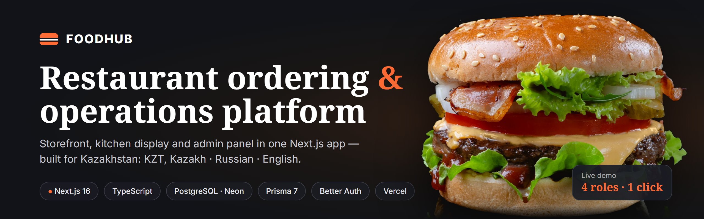

<br>

**Online ordering, a live kitchen display and an admin panel in one app, built for restaurants in Kazakhstan.**

<br>

[](https://foodhub-eta-nine.vercel.app)

[](https://nextjs.org)
[](https://react.dev)
[](https://www.typescriptlang.org)
[](https://neon.tech)
[](https://www.prisma.io)
[](https://tailwindcss.com)
[](https://vercel.com)
[](docs/TESTING.md)

[**Live demo**](https://foodhub-eta-nine.vercel.app) · [**5-minute walkthrough**](docs/DEMO_GUIDE.md) · [**Case study**](docs/CASE_STUDY.md) · [Architecture](docs/ARCHITECTURE.md) · [Testing](docs/TESTING.md) · [Deployment](docs/DEPLOYMENT.md)

</div>

---

> [!NOTE]
> **FoodHub is a portfolio project with a demo restaurant.** The menu, address and contacts are sample content, and orders are not actually delivered. Everything else is real: orders are stored in PostgreSQL, prices are calculated on the server, and every panel enforces its permissions on the server.

## Contents

- [Try it in one click](#-try-it-in-one-click)
- [Screenshots](#-screenshots)
- [Features](#-features)
- [Tech stack](#-tech-stack)
- [Architecture & infrastructure](#-architecture--infrastructure)
- [Engineering highlights](#-engineering-highlights)
- [Getting started](#-getting-started)
- [Testing](#-testing)
- [Deployment](#-deployment)
- [Project structure](#-project-structure)
- [Limitations](#-limitations)

## ⚡ Try it in one click

Open the [login page](https://foodhub-eta-nine.vercel.app/en/login) and pick a role under **Demo accounts**. No password is needed. Once you're in, a floating **Demo** bar lets you switch roles in one click. Each switch creates a real server session, so the permission checks you see are the same ones real users get.

| Role | Opens | What to try |
|---|---|---|
| 👤 **Customer** | `/account` | Order history, saved addresses, favourites |
| 👨‍🍳 **Kitchen** | `/kitchen` | Accept an order → start cooking → mark ready |
| 📋 **Manager** | `/admin` | Orders, menu editor, promo codes, analytics |
| 🛡️ **Admin** | `/admin` | Everything, including staff roles and settings |

Guests can order without an account: add a dish, check out with **Pickup**, and follow the private tracking page.

<sub>Demo accounts can't change roles or settings, delete data or change passwords. Other customers' personal data is masked for them. The data resets every night at 02:00 (Almaty).</sub>

## 📸 Screenshots

<table>
  <tr>
    <td colspan="2">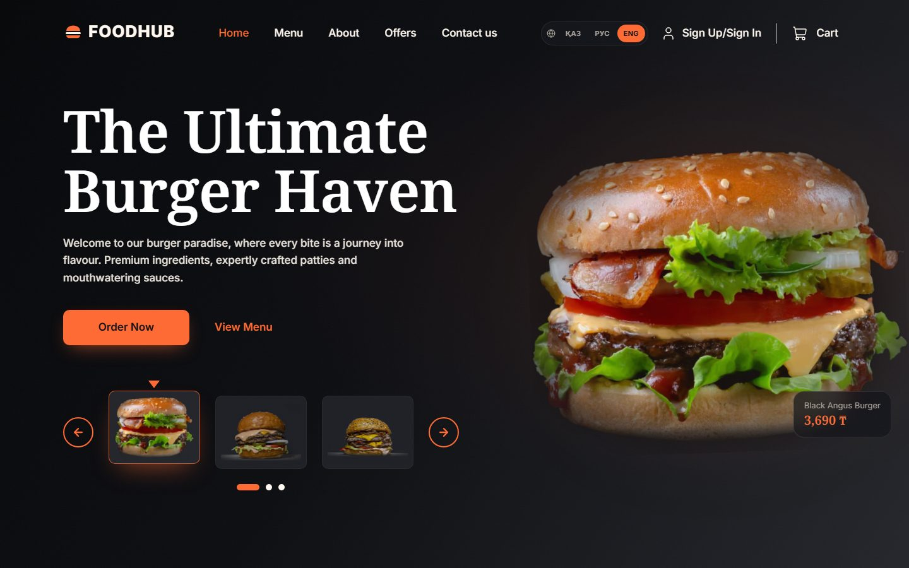<p align="center"><b>Storefront</b>: dark hero with a dish carousel; Kazakh by default, plus Russian and English</p></td>
  </tr>
  <tr>
    <td width="50%">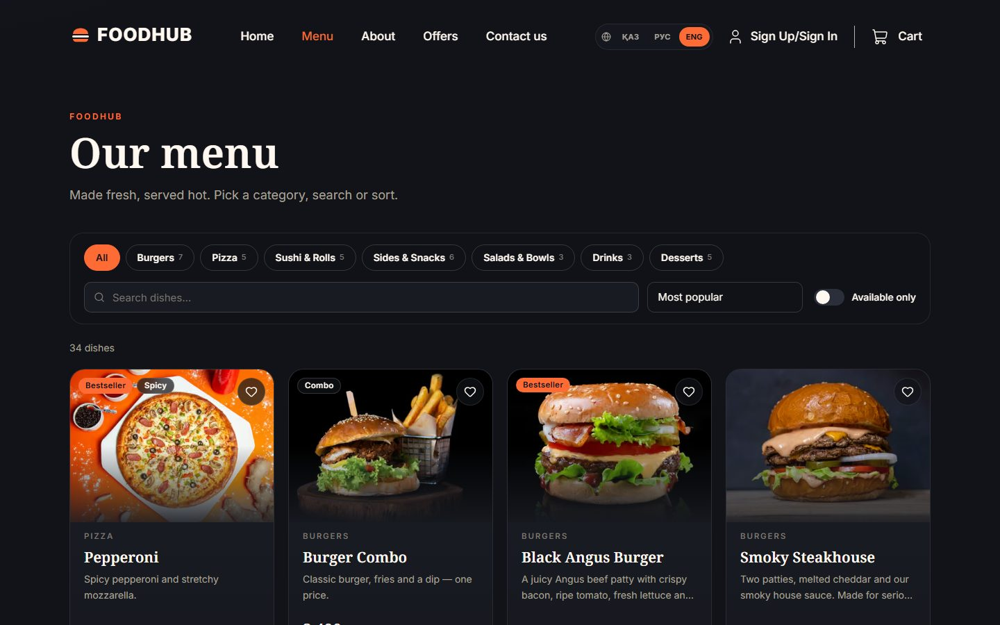<p align="center"><b>Menu</b>: categories, search, sorting, availability filter</p></td>
    <td width="50%">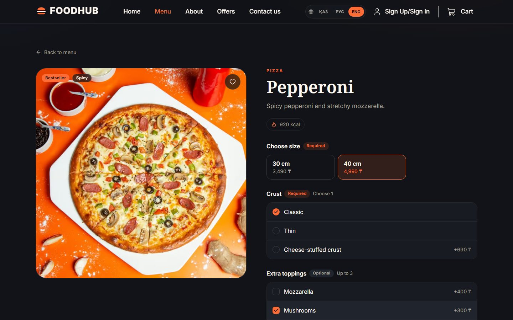<p align="center"><b>Product</b>: sizes, required and optional modifiers, live price</p></td>
  </tr>
  <tr>
    <td width="50%">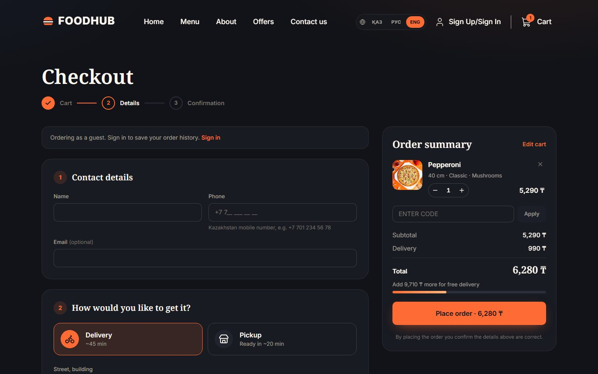<p align="center"><b>Checkout</b>: delivery or pickup, promo codes, server-side totals</p></td>
    <td width="50%">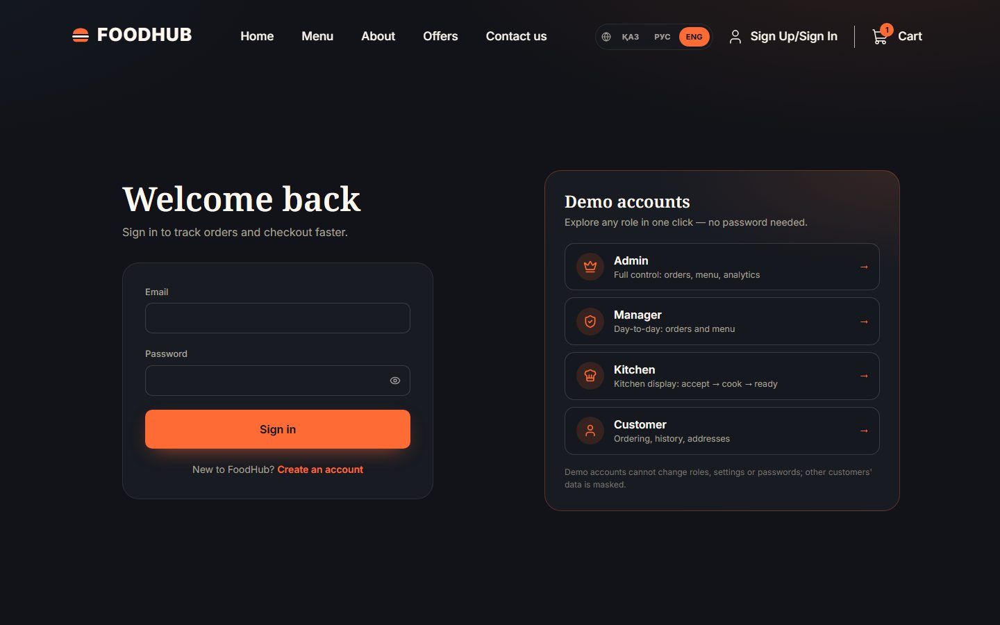<p align="center"><b>One-click demo login</b> for all four roles</p></td>
  </tr>
  <tr>
    <td colspan="2">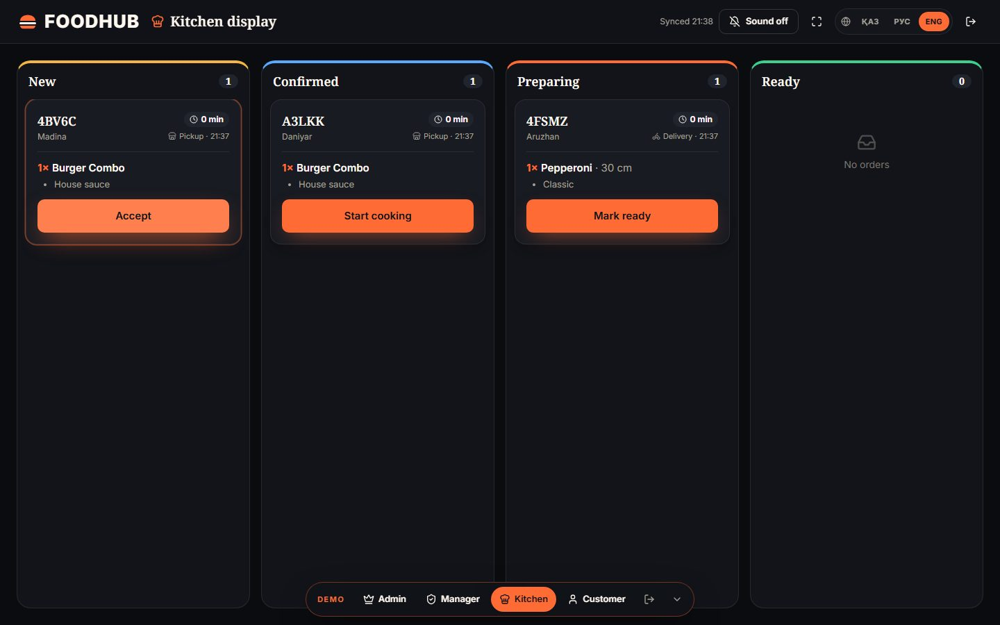<p align="center"><b>Kitchen display</b>: live board (New → Confirmed → Preparing → Ready), timers and one-tap status changes</p></td>
  </tr>
  <tr>
    <td width="50%">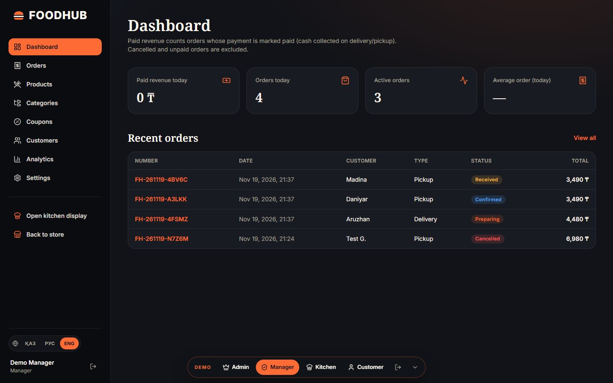<p align="center"><b>Admin dashboard</b>: today's orders and recent activity</p></td>
    <td width="50%">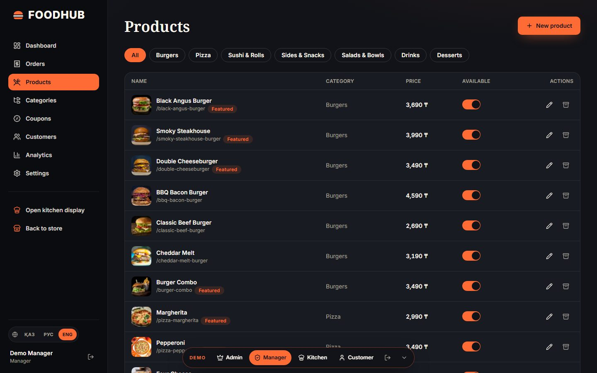<p align="center"><b>Menu management</b>: products, variants, modifiers, availability</p></td>
  </tr>
</table>

<p align="center">
  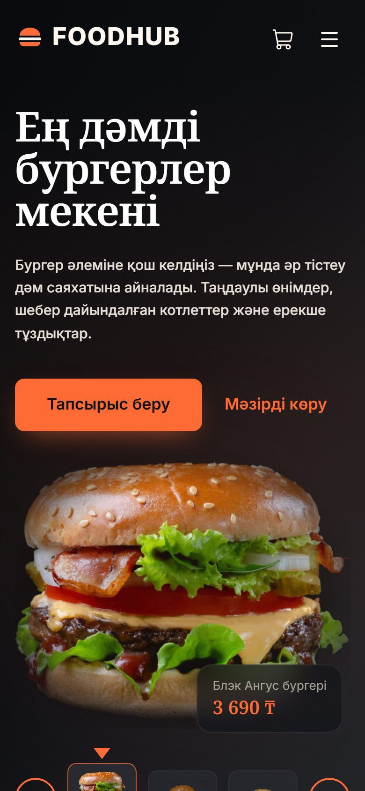&nbsp;
  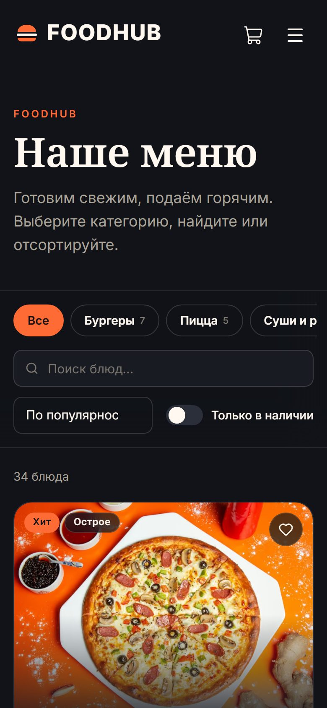&nbsp;
  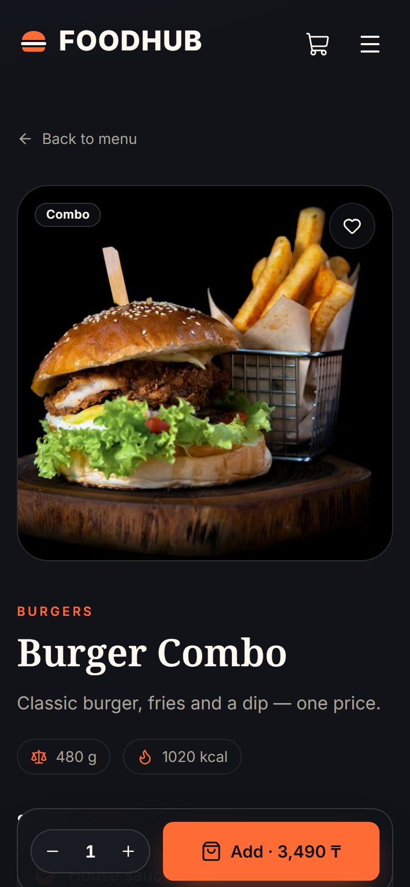
  <br><sub><b>Mobile-first</b>: home (Kazakh), menu (Russian), product page (English)</sub>
</p>

## ✨ Features

<table>
<tr><td valign="top" width="50%">

### 🛒 Storefront
- Menu with categories, search, sorting and an availability filter
- Products with sizes and modifier groups (required and optional)
- Cart drawer and cart page with **server-side price quotes**
- Checkout for delivery or pickup, promo codes, minimum order and free-delivery threshold
- Private order tracking that updates automatically
- Offers, about and contact pages

### 👤 Customer accounts
- Email and password sign-up/sign-in with database sessions
- Order history, saved addresses, favourites
- The guest cart merges into the account cart on sign-in

</td><td valign="top" width="50%">

### 👨‍🍳 Kitchen display
- Four live columns with timers and priority colours
- One-tap status changes, comments, a chime for new orders
- Tablet-friendly full-screen mode

### 📋 Admin panel
- Orders: filter, search, status actions, full history
- Menu editor: products, variants, modifiers, categories, availability
- Promo codes, customers and staff roles
- **Analytics**: revenue by day, week or month, average order value, top dishes, peak hours, CSV export
- Settings: delivery fee, minimum order, opening hours, accepting orders

</td></tr>
</table>

**Across the whole app:**
- 🌐 Kazakh (default, no URL prefix), Russian and English, including validation messages and statuses
- 💸 Correct KZT formatting
- 🔍 SEO: metadata, Open Graph, hreflang, sitemap, JSON-LD
- ♿ Accessibility: keyboard navigation, skip link, ARIA labels, reduced-motion support

## 🧰 Tech stack

| Layer | Technology | Why |
|---|---|---|
| Framework | [Next.js 16](https://nextjs.org) (App Router, Server Actions) · [React 19](https://react.dev) | Server rendering, one codebase for UI and API |
| Language | [TypeScript](https://www.typescriptlang.org) (strict) · [Zod 4](https://zod.dev) | Type safety, validation at every boundary |
| Database | [PostgreSQL on Neon](https://neon.tech) (serverless) | Managed Postgres that scales to zero; branchable test DBs |
| ORM | [Prisma 7](https://www.prisma.io) with the Neon serverless adapter | Typed queries, migrations, transactions |
| Auth | [Better Auth](https://www.better-auth.com) | DB sessions, scrypt hashing, rate limiting, role-based access |
| i18n | [next-intl](https://next-intl.dev) | kk / ru / en routing and messages |
| UI | [Tailwind CSS 4](https://tailwindcss.com) · [Radix UI](https://www.radix-ui.com) · [Motion](https://motion.dev) · [Lucide](https://lucide.dev) · [Sonner](https://sonner.emilkowal.ski) | Accessible primitives, consistent design system |
| State & forms | [Zustand](https://zustand.docs.pmnd.rs) · [React Hook Form](https://react-hook-form.com) | Persistent cart, validated forms |
| Charts | [Recharts](https://recharts.org) | Analytics dashboards |
| Testing | [Vitest](https://vitest.dev) · [Playwright](https://playwright.dev) | Unit, integration on real Postgres, end-to-end |
| Hosting | [Vercel](https://vercel.com) (fra1) + Vercel Cron | Git-based deploys, nightly demo reset |

## 🏗️ Architecture & infrastructure

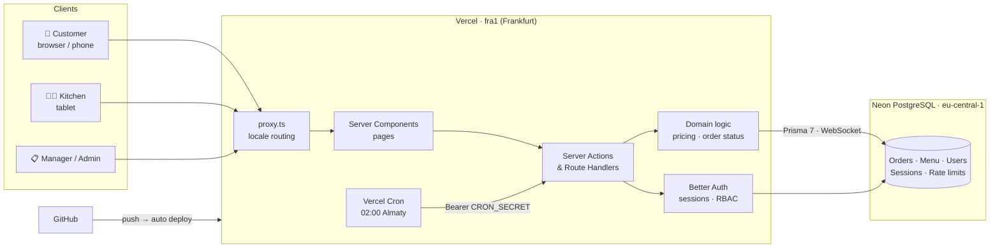

**Order lifecycle** (each transition is checked against the actor's role and written to the history):

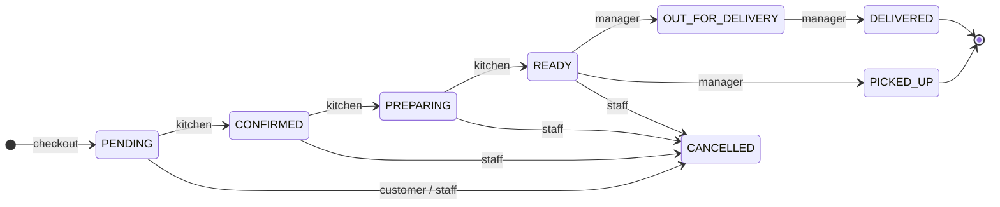

| Piece | Where | Notes |
|---|---|---|
| App | Vercel, region `fra1` | Every push to `main` deploys; public pages are ISR (5 min) and revalidate on admin edits |
| Database | Neon PostgreSQL, AWS `eu-central-1` | Same region as the app; pooled connection at runtime, direct connection for migrations |
| Scheduled jobs | Vercel Cron → `/api/cron/demo-reset` | Nightly showcase reset, protected by `CRON_SECRET`, disabled unless explicitly enabled |
| Secrets | Vercel environment variables | Nothing secret in the repo; `.env.example` documents every variable |
| Tests | Separate `foodhub_test` database | Integration and E2E tests never touch the live database |

## 🧠 Engineering highlights

- **The server owns every price.** The browser sends only IDs. Totals, modifiers, coupons, delivery fee and minimum order are recalculated from the database in one transaction, and each order stores a snapshot of names and prices.
- **Idempotent checkout.** A double click or a retried request returns the same order instead of creating two. Coupon limits use an atomic conditional update.
- **Order status as a state machine.** Explicit transitions with role checks; every change is recorded with its actor.
- **Private tracking without an account.** Tracking links carry an HMAC-derived token, and only its hash is stored.
- **Built for serverless Postgres.**
  - Reads are retried with back-off while Neon wakes up.
  - Writes are never retried automatically; checkout relies on its idempotency key instead.
  - Transaction time limits are tuned for cold starts.
- **Security.** On the security side, the app has:
  - server-side RBAC and ownership checks, plus Zod validation on every input;
  - rate limits stored in PostgreSQL;
  - origin checks on POST/PUT, CSV-injection escaping and strict security headers;
  - generic auth errors, so accounts can't be enumerated.
- **A public demo that's safe to share.**
  - Restrictions are enforced in the auth layer and server actions, not just hidden in the UI.
  - Personal data is masked for demo users.
  - A nightly reset compares the database with the seed and writes only what changed.

More detail in [docs/CASE_STUDY.md](docs/CASE_STUDY.md) and [docs/ARCHITECTURE.md](docs/ARCHITECTURE.md).

## 🚀 Getting started

**Requirements:** Node.js ≥ 22, npm, a free [Neon](https://neon.tech) project.

```bash
git clone https://github.com/Sailauov08/FoodHub.git
cd FoodHub
npm install
cp .env.example .env        # then fill in the values (see below)
npm run db:deploy           # apply migrations
npm run db:seed             # restaurant, 7 categories, 34 dishes, promo codes, demo accounts
npm run dev
```

Open <http://localhost:3000> (Kazakh), `/ru` or `/en`.

> [!TIP]
> **No database yet?** Leave `DATABASE_URL` empty and run `npm run dev`. The storefront runs read-only from the seed menu, so you can browse the design. Ordering, sign-in and the staff panels need the database.

### Environment variables

| Name | Required | Description |
|---|---|---|
| `DATABASE_URL` | ✅ | Neon **pooled** connection string (host contains `-pooler`) |
| `DIRECT_URL` | ✅ | Neon **direct** connection string, used by migrations and the seed |
| `BETTER_AUTH_SECRET` | ✅ | 32+ random bytes; signs sessions and order-tracking tokens |
| `BETTER_AUTH_URL` / `NEXT_PUBLIC_SITE_URL` | ✅ | Public base URL, e.g. `https://your-domain.kz` |
| `SEED_ADMIN_EMAIL` / `SEED_ADMIN_PASSWORD` | — | Your private admin account (also `SEED_MANAGER_*`, `SEED_KITCHEN_*`) |
| `DEMO_PASSWORD` | — | Enables the four public demo accounts |
| `DEMO_RESET_ENABLED` / `CRON_SECRET` | — | Nightly showcase reset (**never** enable it for a real restaurant) |
| `TEST_DATABASE_URL` | tests | A **separate** database; integration tests wipe it |

### Scripts

| Command | What it does |
|---|---|
| `npm run dev` / `build` / `start` | Develop, build, run production |
| `npm run lint` / `typecheck` | ESLint / TypeScript |
| `npm run test:unit` / `test:integration` | Vitest (integration needs `TEST_DATABASE_URL`) |
| `npm run test:e2e` / `test:e2e:preview` | Playwright, with a database / with no database |
| `npm run db:migrate` / `db:deploy` / `db:seed` | Prisma migrations and the idempotent seed |
| `npm run demo:reset` | Run the showcase reset manually (requires `DEMO_RESET_ENABLED=true`) |

## ✅ Testing

| Suite | Count | Covers |
|---|---:|---|
| Unit (Vitest) | 58 | Pricing, validation, status machine, KZT/date formatting, retry logic, demo masking |
| Integration (real PostgreSQL) | 20 | Checkout and pricing, coupon limits, idempotency, status permissions, admin actions, demo restrictions, nightly reset |
| E2E with a database (Playwright) | 11 | Sign-up → order → history, guest checkout and cancellation, kitchen workflow, admin product lifecycle, access control, mobile |
| E2E preview (Playwright) | 38 | Every public page in all three languages, carousel, cart, checkout validation, mobile navigation |

TypeScript strict, ESLint and the production build are clean. Details: [docs/TESTING.md](docs/TESTING.md).

## ☁️ Deployment

Push to GitHub, then import the repository in Vercel and add the environment variables. Create the Neon project in the same region as the Vercel functions (here, Frankfurt). Step-by-step guide and production checklist: [docs/DEPLOYMENT.md](docs/DEPLOYMENT.md).

## 📁 Project structure

```
src/
├── app/[locale]/        # Pages: (store) storefront & account, admin/, kitchen/
├── app/api/             # Route handlers: auth, cart, favorites, orders, kitchen feed, CSV reports, cron
├── actions/             # Server actions: orders, account, admin, demo login
├── server/              # Server-only services: orders, analytics, catalog, rate limit, demo reset
├── lib/domain/          # Pure business logic: pricing, order status, money, phone, opening hours
├── lib/                 # Auth, DB client (with retry), validation, sessions
├── components/          # store/, admin/, kitchen/, demo/, ui/ (Radix-based)
├── i18n/ · stores/      # next-intl config · Zustand cart
└── proxy.ts             # Locale routing
prisma/                  # Schema, migrations, seed and seed data
messages/                # kk.json · ru.json · en.json
tests/                   # unit/ and integration/ (Vitest)
e2e/                     # Playwright specs
docs/                    # Case study, architecture, testing, deployment, demo guide
```

## 🚧 Limitations

These need a real business account with an external provider, so they are intentionally not included:

- online card payments (only cash on delivery or at pickup);
- email or SMS notifications;
- courier tracking.

Payments are already tracked separately from order status, so a payment provider can be added without reworking the order flow.

On Neon's free tier, the first request after a quiet period takes a few seconds while the database wakes up.

---

<div align="center">

Built by **[Bekarys Sailauov](https://github.com/Sailauov08)** · Photos from [Unsplash](public/images/CREDITS.md) (Unsplash License)

</div>
